# TaskFlow DevOps

Tablero web de tareas académico para practicar **DevOps** (CI, pruebas automatizadas, protección de rama y entrega continua) con un flujo Spec-Driven (OpenSpec / Specboot).

## Stack

| Capa | Tecnología |
|------|------------|
| Backend | Python 3.11+, Flask, SQLite |
| Frontend | HTML, CSS, JavaScript (tablero Kanban) |
| Pruebas | Pytest |
| CI/CD | GitHub Actions (`CI` → Pytest; `CD` → Render tras CI verde en `main`) |

## Roles

| Rol | Capacidades |
|-----|-------------|
| **Admin** | Registro y gestión de usuarios |
| **Developer** | CRUD de tareas, transiciones de estado, asignado, prioridad y fecha límite |
| **Viewer** | Solo lectura del tablero |

Reglas de negocio: un solo asignado (RN01); título, fecha límite y prioridad obligatorios (RN02); `main` protegida por pruebas verdes antes de merge/despliegue (RN03); no se permite saltar de To Do a Done (RN04).

## Diseño y modelado del sistema

TaskFlow es una aplicación web monolítica: el navegador habla con un solo proceso Flask, que persiste usuarios y tareas en SQLite y se publica en Render solo después de que CI pase en `main`.

### Arquitectura de contexto

Actores y sistemas externos. El tablero no depende de otros servicios de negocio; GitHub y Render cubren verificación y publicación.

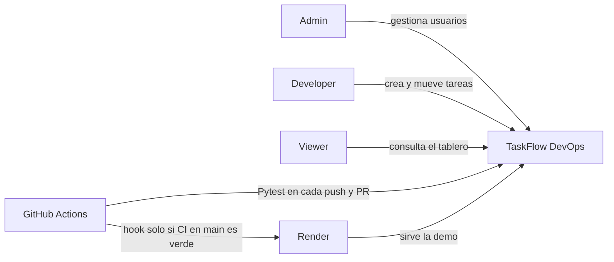

### Arquitectura lógica

Cuatro capas dentro del mismo proceso. Las páginas HTML no acceden a la base: el JavaScript del tablero llama a la API JSON.

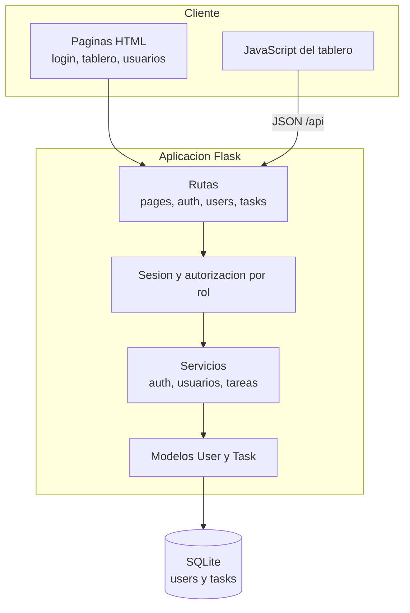

| Capa | Responsabilidad | Ubicación |
|------|-----------------|-----------|
| Presentación | Login, tablero Kanban y pantalla de usuarios | `templates/`, `static/` |
| API y páginas | HTTP, códigos de estado y redirecciones | `app/routes/` |
| Autorización | Cookie de sesión firmada; decoradores por rol | `app/auth/`, `app/services/auth_service.py` |
| Dominio | Validación RN01–RN04 y casos de uso | `app/services/`, `app/models/` |
| Persistencia | Tablas `users` y `tasks`, claves foráneas | `app/db.py` |

Puntos de entrada: en local, `flask --app app run`; en producción, Gunicorn carga `wsgi:app`, que llama a `create_app()`.

### Flujo de una petición

Ejemplo: un Developer mueve una tarea de To Do a In progress.

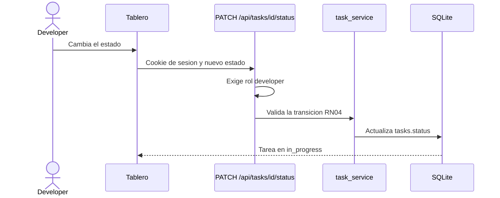

Admin y Viewer que llamen a un endpoint de escritura reciben `403`. Sin sesión, las páginas protegidas redirigen a `/login`.

### Modelo de dominio

Dos entidades persistidas. El tablero no es una tabla: es la vista que agrupa tareas por `status`.

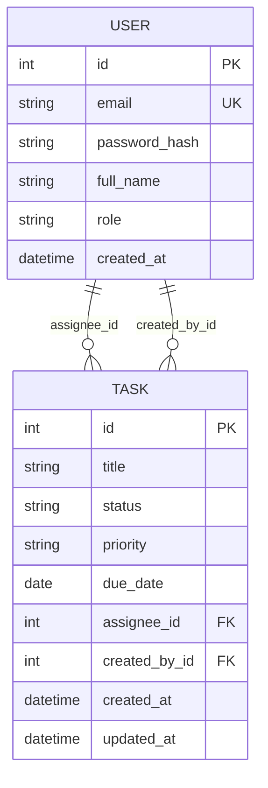

| Concepto | Valores | Regla |
|----------|---------|--------|
| Rol | `admin`, `developer`, `viewer` | Define qué pantallas y endpoints puede usar |
| Estado | `todo`, `in_progress`, `done` | Columna del tablero |
| Prioridad | `high`, `medium`, `low` | Obligatoria (RN02) |
| Asignado | como máximo un `assignee_id` | RN01 |
| Sesión | cookie firmada con `SECRET_KEY` | No se guarda en SQLite |

Detalle de campos y contratos: [`docs/data-model.md`](docs/data-model.md) y [`docs/api-spec.yml`](docs/api-spec.yml).

### Diagrama de clases

El rol no es una subclase: vive en `User.role`. `Task` conoce a su creador y, como máximo, a un asignado. Los servicios aplican las reglas de negocio; las rutas HTTP solo delegan.

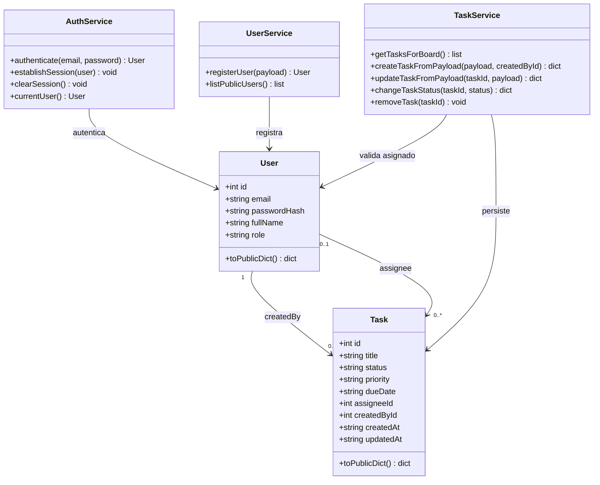

| Clase | Dónde vive | Qué decide |
|-------|------------|------------|
| `User`, `Task` | `app/models/` | Forma de los datos y mapeo a SQLite |
| `AuthService` | `app/services/auth_service.py` | Credenciales y cookie de sesión |
| `UserService` | `app/services/user_service.py` | Alta de usuarios (solo Admin) |
| `TaskService` | `app/services/task_service.py` | RN01, RN02 y RN04 |

### Diagramas de actividad

#### Inicio de sesión

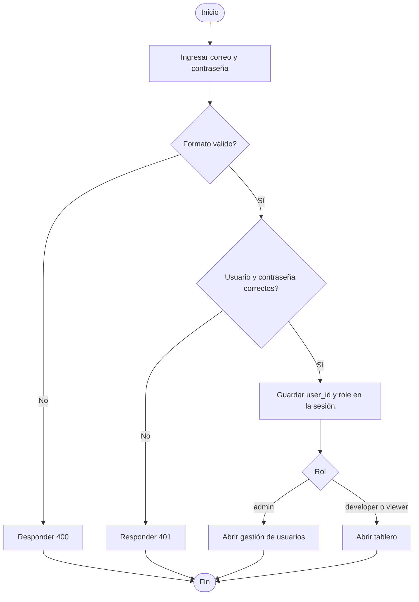

#### Alta de una tarea

Solo el Developer llega a crear. La tarea nace en `todo`.

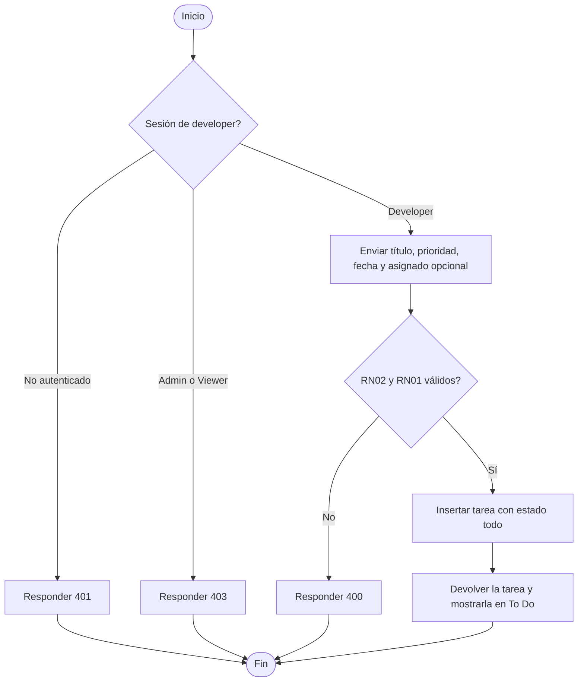

#### Cambio de estado

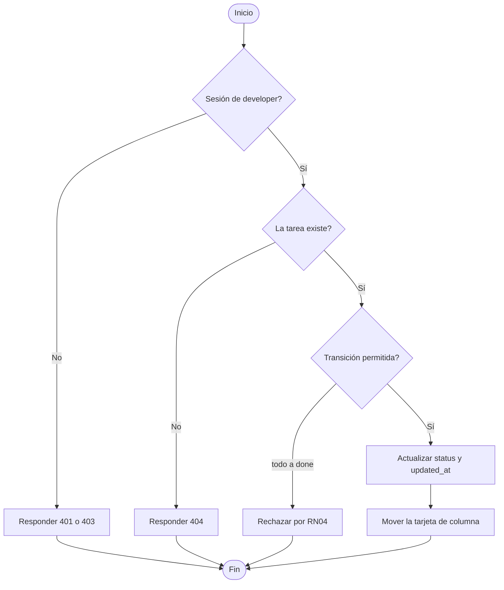

#### Registro de usuario

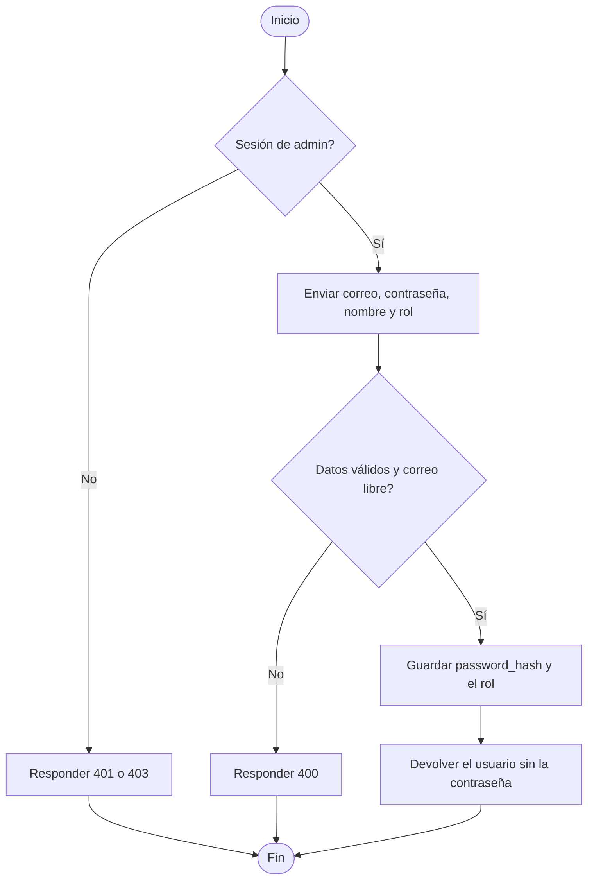

### Modelo de estados de una tarea

Una tarea nueva nace en `todo`. Se puede retroceder; no se puede saltar de To Do a Done (RN04).

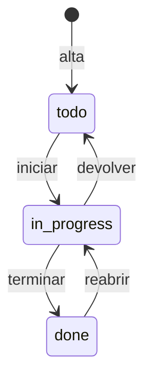

El salto `todo` → `done` no forma parte del modelo: el servicio lo rechaza.

### Arquitectura de despliegue

`main` está protegida: el merge exige el check **Pytest**. El workflow de CD no tiene disparo manual; solo corre si ese CI terminó en éxito y la rama es `main`.

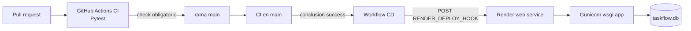

| Pieza | Rol |
|-------|-----|
| `.github/workflows/ci.yml` | Instala dependencias y ejecuta Pytest en push y pull request |
| Protección de `main` | Impide el merge sin el check Pytest (RN03) |
| `.github/workflows/cd.yml` | Dispara el deploy hook de Render |
| `render.yaml` | Servicio Python free: build con pip, arranque con Gunicorn, health check en `/login` |
| `SECRET_KEY` | Variable de entorno en Render; la app no arranca en producción con el valor de desarrollo |

## Inicio rápido (local)

```bash
python -m venv .venv
# Windows
.venv\Scripts\activate
# macOS/Linux
source .venv/bin/activate

pip install -r requirements.txt
cp .env.example .env   # define un SECRET_KEY real
python scripts/seed_users.py
pytest
flask --app app run
```

Aplicación: [http://localhost:5000](http://localhost:5000) — inicio de sesión en `/login`.

### Usuarios de demostración

| Correo | Contraseña | Rol |
|--------|------------|-----|
| `admin@taskflow.local` | `Admin123!` | admin |
| `dev@taskflow.local` | `Dev123!` | developer |
| `viewer@taskflow.local` | `Viewer123!` | viewer |

En arranques que no son de prueba, la aplicación también crea estos usuarios si faltan (útil en demos alojadas).

## CI / CD

- **CI** (`.github/workflows/ci.yml`): ejecuta Pytest en push y pull requests. Check obligatorio en `main`: **`Pytest`**.
- **CD** (`.github/workflows/cd.yml`): tras un **CI exitoso en `main`**, dispara el deploy hook de Render (secreto `RENDER_DEPLOY_HOOK`).
- Guías operativas: [`docs/branch-protection.md`](docs/branch-protection.md), [`docs/continuous-delivery.md`](docs/continuous-delivery.md).

## Estructura del proyecto

```
app/                 # Aplicación Flask
templates/ static/   # Interfaz
tests/               # Suite Pytest
scripts/             # Utilidades de seed
.github/workflows/   # CI + CD
docs/                # Estándares, API, modelo de datos, guías
openspec/            # Especificaciones e historial de cambios
US/                  # Historias de usuario (us01–us15)
```

## Documentación

| Documento | Propósito |
|-----------|-----------|
| [`docs/development_guide.md`](docs/development_guide.md) | Setup local, API, pasos de CI/CD |
| [`docs/api-spec.yml`](docs/api-spec.yml) | Contratos HTTP |
| [`docs/data-model.md`](docs/data-model.md) | Modelo de dominio |
| [`docs/base-standards.md`](docs/base-standards.md) | Reglas de desarrollo (TDD, etc.) |
| [`README_specboot.md`](README_specboot.md) | Configuración Specboot / agentes |

## Flujo Spec-Driven

Las historias están en `US/us01.md` … `US/us15.md`. Los cambios se planifican y archivan con OpenSpec (`openspec/`). Consulta la guía de desarrollo para el flujo recomendado (`/apply` → `/verify` → `/adversarial-review` → `/archive` → `/commit`).

## Licencia

Proyecto académico — TaskFlow DevOps.
