# TaskFlow DevOps

Tablero web de tareas académico para practicar **DevOps** (CI, pruebas automatizadas, protección de rama y entrega continua) con un flujo Spec-Driven (OpenSpec / Specboot).

## Stack

| Capa | Tecnología |
|------|------------|
| Backend | Python 3.11+, Flask, SQLite |
| Frontend | HTML, CSS, JavaScript (tablero Kanban) |
| Pruebas | Pytest |
| CI/CD | GitHub Actions (`CI` → Pytest; `CD` → Render tras CI verde en `main`) |

## Roles

| Rol | Capacidades |
|-----|-------------|
| **Admin** | Registro y gestión de usuarios |
| **Developer** | CRUD de tareas, transiciones de estado, asignado, prioridad y fecha límite |
| **Viewer** | Solo lectura del tablero |

Reglas de negocio: un solo asignado (RN01); título, fecha límite y prioridad obligatorios (RN02); `main` protegida por pruebas verdes antes de merge/despliegue (RN03); no se permite saltar de To Do a Done (RN04).

## Diseño y modelado del sistema

Los modelos siguen la semana 5: contexto, casos de uso, clases, secuencia, actividad, estados y flujo de datos. Cada uno muestra una vista del mismo sistema y omite el resto.

TaskFlow es una aplicación web: el navegador habla con un proceso Flask y las tareas quedan en SQLite. GitHub Actions y Render están fuera de la frontera del producto; verifican y publican el sistema.

### Modelo de contexto

Muestra el sistema en su entorno y marca la frontera con actores y sistemas externos.

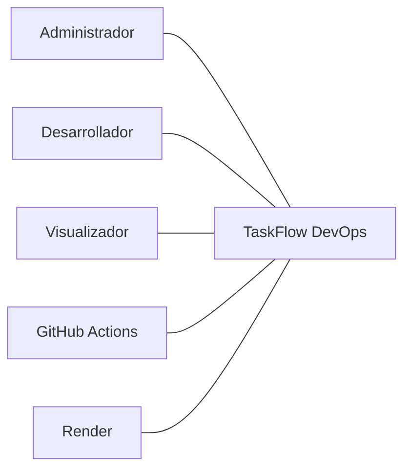

| Elemento externo | Relación con el sistema |
|------------------|-------------------------|
| Administrador, Desarrollador, Visualizador | Usan el tablero según su rol |
| GitHub Actions | Ejecuta Pytest y, si `main` queda verde, pide el despliegue |
| Render | Publica la demo; no participa en las reglas del tablero |

### Diagrama de casos de uso

Los actores son roles externos. La elipse es una función que el usuario percibe. La línea continua es la interacción del actor. `<<include>>` es una función que el caso siempre utiliza. `<<extend>>` es un comportamiento opcional: el asignado no es obligatorio al crear o editar.

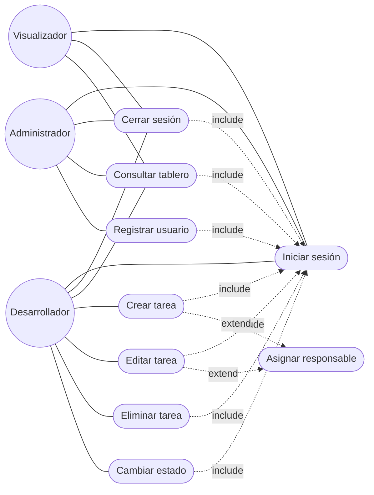

### Diagrama de clases

Estructura estática del negocio. Los atributos van con visibilidad privada, como en el ejemplo de la materia. Las multiplicidades van en los extremos de la asociación.

`Usuario` y `Tarea` corresponden a `User` y `Task`. El ejemplo de clase de la materia usa generalización (Persona y Personal). Aquí no hay subclases: Administrador, Desarrollador y Visualizador comparten los mismos datos y se distinguen por el atributo `rol`.

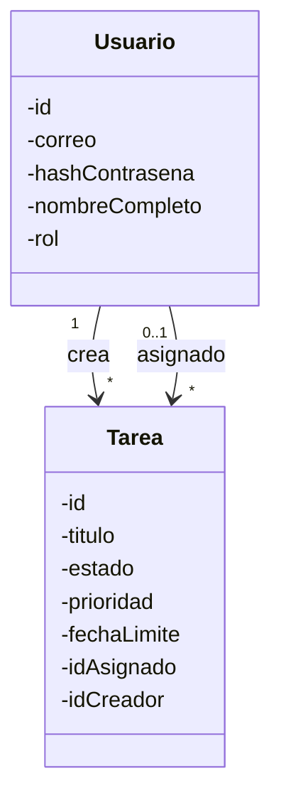

| Concepto | Valores | Regla |
|----------|---------|--------|
| Rol | `admin`, `developer`, `viewer` | Define qué casos de uso puede iniciar |
| Estado | `todo`, `in_progress`, `done` | Columna del tablero |
| Prioridad | `high`, `medium`, `low` | Obligatoria (RN02) |
| Asignado | como máximo un usuario | RN01 |
| Sesión | cookie firmada con `SECRET_KEY` | No es una clase persistida |

Detalle de campos y contratos: [`docs/data-model.md`](docs/data-model.md) y [`docs/api-spec.yml`](docs/api-spec.yml).

### Diagrama de secuencia

Agrega el detalle del caso de uso **Cambiar estado**: los objetos que participan y el orden de los mensajes. La respuesta vuelve con línea discontinua.

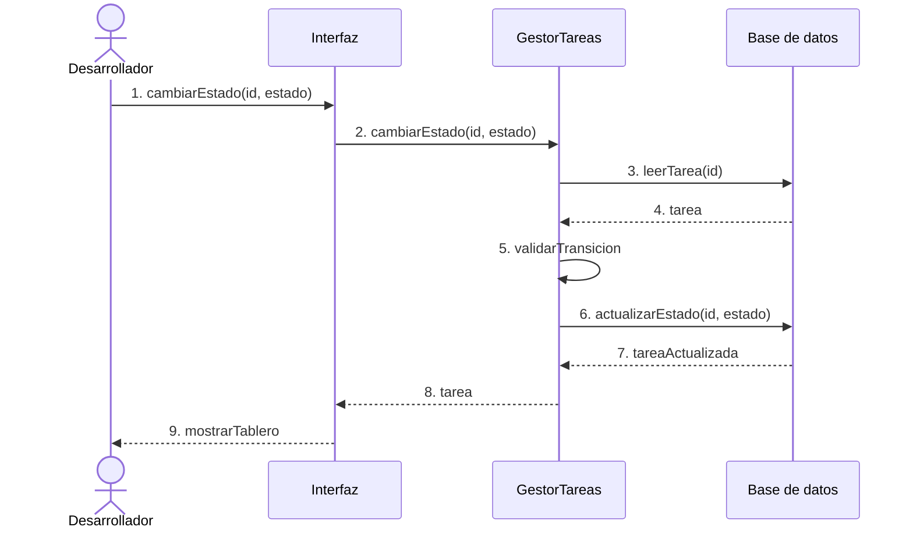

Si el actor no es Desarrollador, `GestorTareas` corta la secuencia y la interfaz muestra el rechazo. Si el salto es de Por hacer a Terminada, el mensaje 5 no llega al mensaje 6.

### Diagramas de actividad

Cada nodo es una acción en verbo. El rombo no lleva la pregunta dentro: la guarda va en la flecha, entre corchetes. El círculo negro es el inicio y el doble círculo es el fin.

#### Iniciar sesión

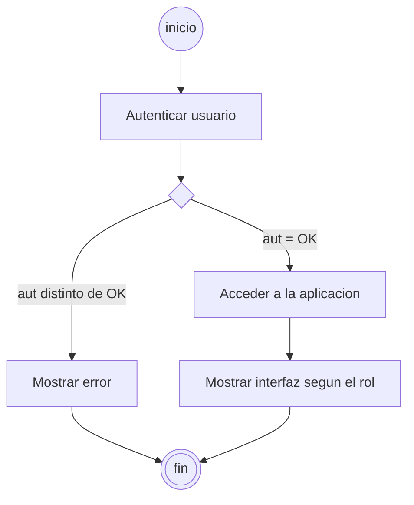

#### Registrar usuario

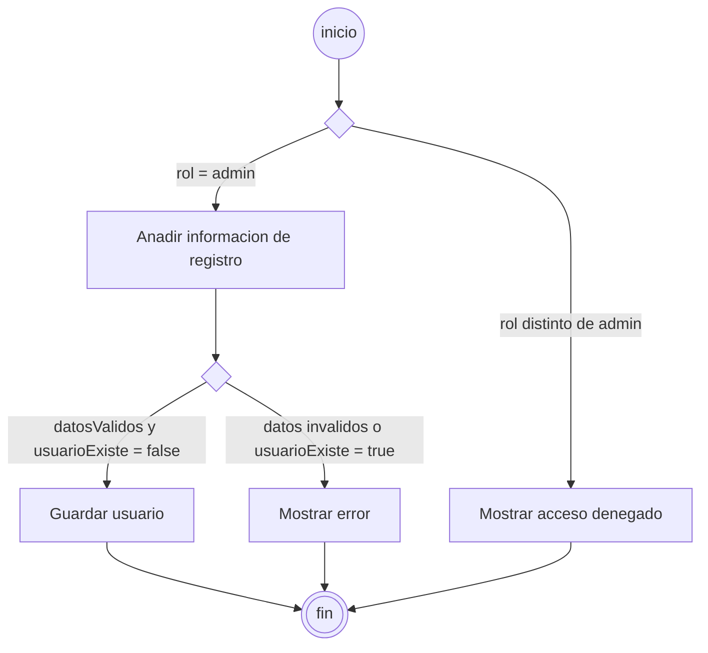

#### Crear tarea

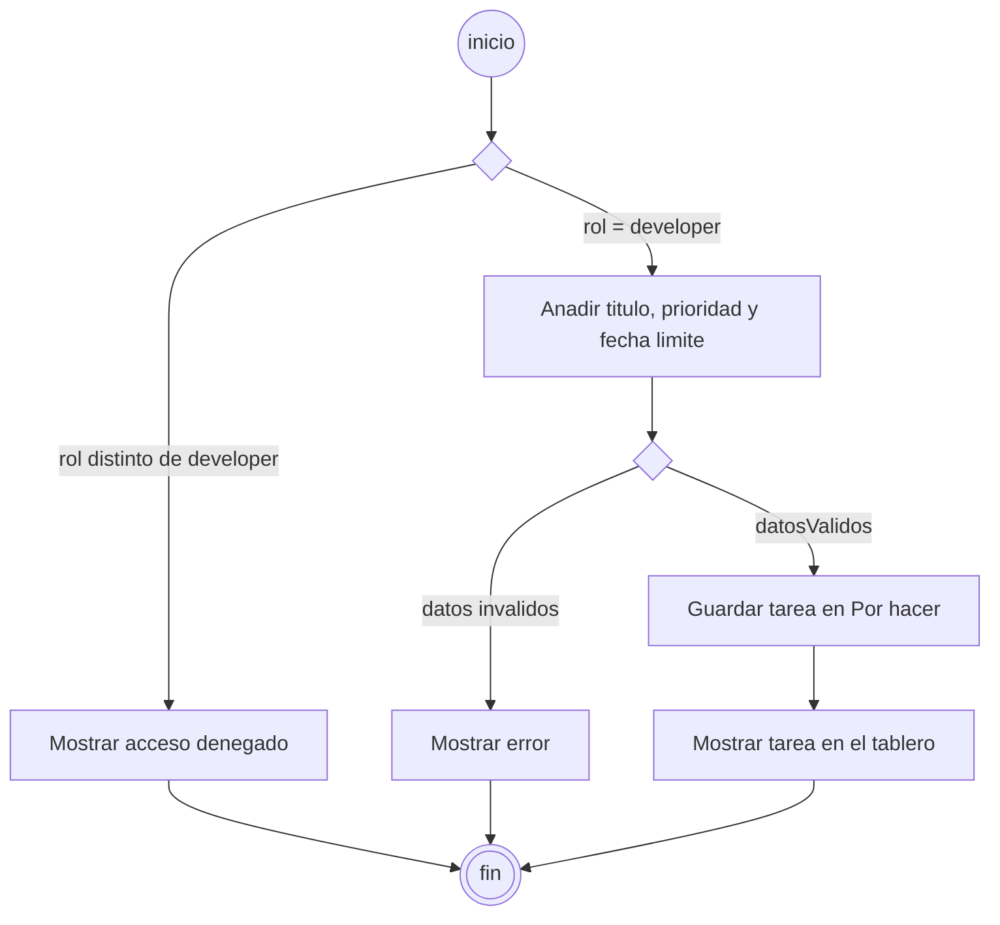

#### Cambiar estado

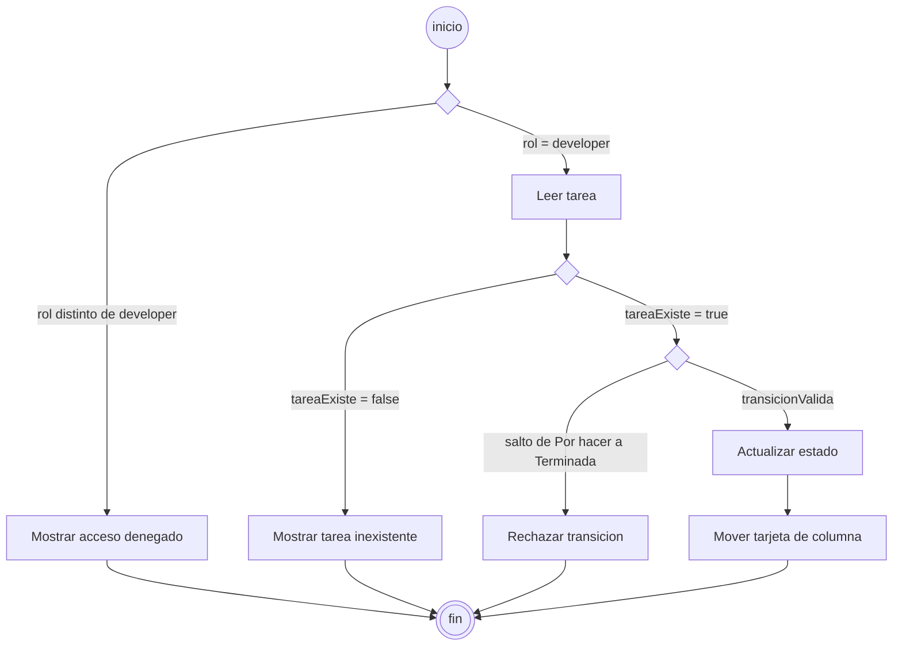

### Diagrama de estados

Modelo de comportamiento de la tarea. Una tarea nueva entra en Por hacer. Puede retroceder. El salto directo a Terminada no es una transición del modelo.

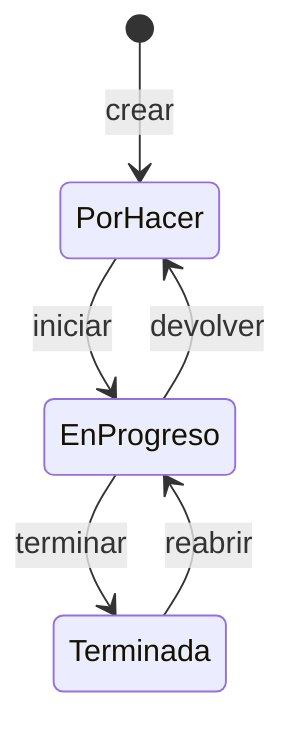

En la base de datos esos estados se guardan como `todo`, `in_progress` y `done`.

### Diagrama de flujo de datos

Muestra qué datos circulan, sin el detalle de la lógica. El nivel 0 es el sistema completo. El nivel 1 abre los procesos y los almacenes.

#### Nivel 0

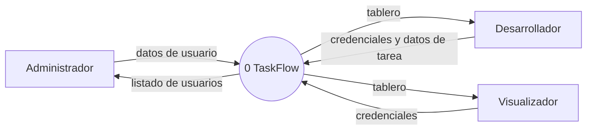

#### Nivel 1

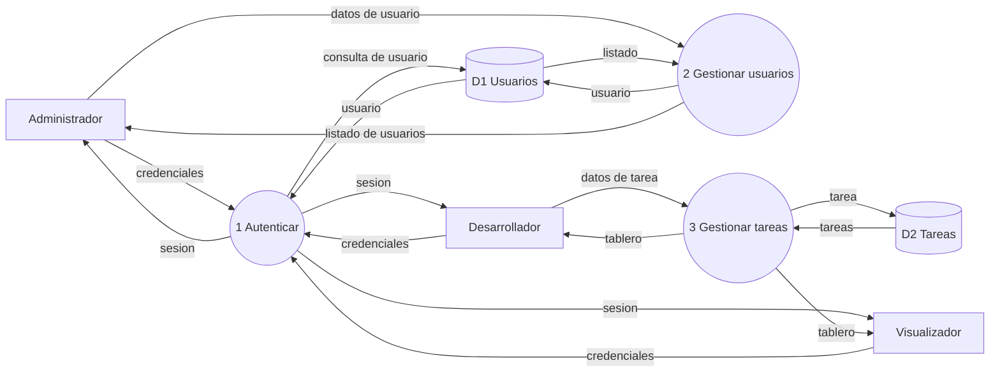

### Publicación del sistema

Este flujo no sustituye a los modelos anteriores. Describe el entorno DevOps: `main` exige el check Pytest y el despliegue solo ocurre si ese CI terminó en éxito.

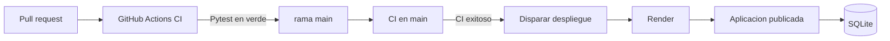

| Pieza | Rol |
|-------|-----|
| `.github/workflows/ci.yml` | Instala dependencias y ejecuta Pytest en push y pull request |
| Protección de `main` | Impide el merge sin el check Pytest (RN03) |
| `.github/workflows/cd.yml` | Dispara el deploy hook de Render |
| `render.yaml` | Servicio Python: build con pip, arranque con Gunicorn, health check en `/login` |
| `SECRET_KEY` | Variable de entorno en Render; la app no arranca en producción con el valor de desarrollo |

## Inicio rápido (local)

```bash
python -m venv .venv
# Windows
.venv\Scripts\activate
# macOS/Linux
source .venv/bin/activate

pip install -r requirements.txt
cp .env.example .env   # define un SECRET_KEY real
python scripts/seed_users.py
pytest
flask --app app run
```

Aplicación: [http://localhost:5000](http://localhost:5000) — inicio de sesión en `/login`.

### Usuarios de demostración

| Correo | Contraseña | Rol |
|--------|------------|-----|
| `admin@taskflow.local` | `Admin123!` | admin |
| `dev@taskflow.local` | `Dev123!` | developer |
| `viewer@taskflow.local` | `Viewer123!` | viewer |

En arranques que no son de prueba, la aplicación también crea estos usuarios si faltan (útil en demos alojadas).

## CI / CD

- **CI** (`.github/workflows/ci.yml`): ejecuta Pytest en push y pull requests. Check obligatorio en `main`: **`Pytest`**.
- **CD** (`.github/workflows/cd.yml`): tras un **CI exitoso en `main`**, dispara el deploy hook de Render (secreto `RENDER_DEPLOY_HOOK`).
- Guías operativas: [`docs/branch-protection.md`](docs/branch-protection.md), [`docs/continuous-delivery.md`](docs/continuous-delivery.md).

## Estructura del proyecto

```
app/                 # Aplicación Flask
templates/ static/   # Interfaz
tests/               # Suite Pytest
scripts/             # Utilidades de seed
.github/workflows/   # CI + CD
docs/                # Estándares, API, modelo de datos, guías
openspec/            # Especificaciones e historial de cambios
US/                  # Historias de usuario (us01–us15)
```

## Documentación

| Documento | Propósito |
|-----------|-----------|
| [`docs/development_guide.md`](docs/development_guide.md) | Setup local, API, pasos de CI/CD |
| [`docs/api-spec.yml`](docs/api-spec.yml) | Contratos HTTP |
| [`docs/data-model.md`](docs/data-model.md) | Modelo de dominio |
| [`docs/base-standards.md`](docs/base-standards.md) | Reglas de desarrollo (TDD, etc.) |
| [`README_specboot.md`](README_specboot.md) | Configuración Specboot / agentes |

## Flujo Spec-Driven

Las historias están en `US/us01.md` … `US/us15.md`. Los cambios se planifican y archivan con OpenSpec (`openspec/`). Consulta la guía de desarrollo para el flujo recomendado (`/apply` → `/verify` → `/adversarial-review` → `/archive` → `/commit`).

## Licencia

Proyecto académico — TaskFlow DevOps.
