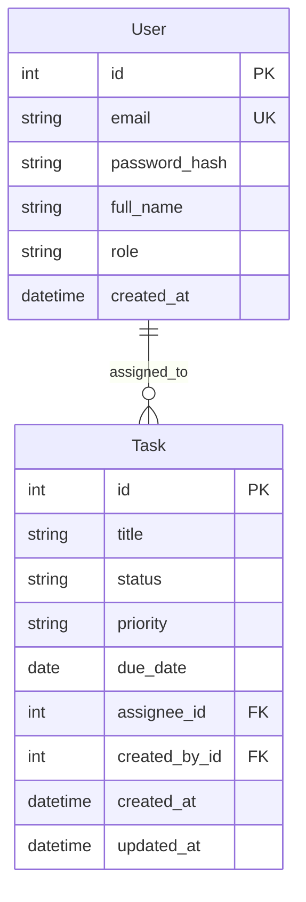

# Data Model — TaskFlow DevOps

Domain entities for the academic task board. Persistence uses SQLite. Data must survive application restart (RNF02).

## Entity Overview

## 1. User

Represents an authenticated person in the system.

| Field | Type | Rules |
|-------|------|--------|
| `id` | integer PK | Auto-generated |
| `email` | string | Required, unique, valid email |
| `password_hash` | string | Required; never store plain-text passwords |
| `full_name` | string | Required |
| `role` | enum | One of: `admin`, `developer`, `viewer` |
| `created_at` | datetime | Set on create |

**Notes**

- Admin registers users and assigns roles via `POST /api/users` (US03); passwords are stored only as `password_hash`.
- Admin lists users via `GET /api/users` without password material.
- Role drives authorization for board and admin actions.

## 2. Task

Represents a work item on the project board.

| Field | Type | Rules |
|-------|------|--------|
| `id` | integer PK | Auto-generated |
| `title` | string | Required (RN02) |
| `status` | enum | `todo`, `in_progress`, `done` |
| `priority` | enum | `high`, `medium`, `low` (RN02) |
| `due_date` | date | Required (RN02) |
| `assignee_id` | FK → User | Optional at model level but business flows assign a single primary responsible (RN01) |
| `created_by_id` | FK → User | Developer who created the task |
| `created_at` | datetime | Set on create |
| `updated_at` | datetime | Updated on change |

**Status transitions (RN04)**

- Allowed: `todo` → `in_progress` → `done`
- Allowed: move backward when needed (`done` → `in_progress`, `in_progress` → `todo`) if product allows; never `todo` → `done` directly
- New tasks start in `todo`

**Assignee (RN01)**

- At most one primary assignee (`assignee_id`)
- Assignee must reference an existing User

**Board (US04 / US05)**

- Authenticated users load tasks via `GET /api/tasks`; the UI groups by `status`
- Developers create tasks via `POST /api/tasks` (required title, priority, due date; optional assignee); Admin and Viewer cannot create
- Developers update task fields via `PUT /api/tasks/{taskId}` (RN02); status changes are separate (US09)
- New tasks start in `todo` and appear in the To Do column
- Viewers may not call mutating task endpoints (`403`)

## Non-persisted Concepts

- **Board**: derived view grouping tasks by `status` columns.
- **Session**: authentication session linking the current user to a role for authorization checks (Flask client-signed cookie). Logout (`POST /api/auth/logout`, US02) clears session data and expires the cookie so that client needs a new login; stolen cookie replay without a denylist is out of scope.

## Alignment

- Functional requirements RF01–RF08 and stories US04–US11 map to Task and Board behavior.
- Auth stories US01–US03 map to User and session handling.
- DevOps stories US12–US15 do not add tables; they govern how code changes are verified and released.
